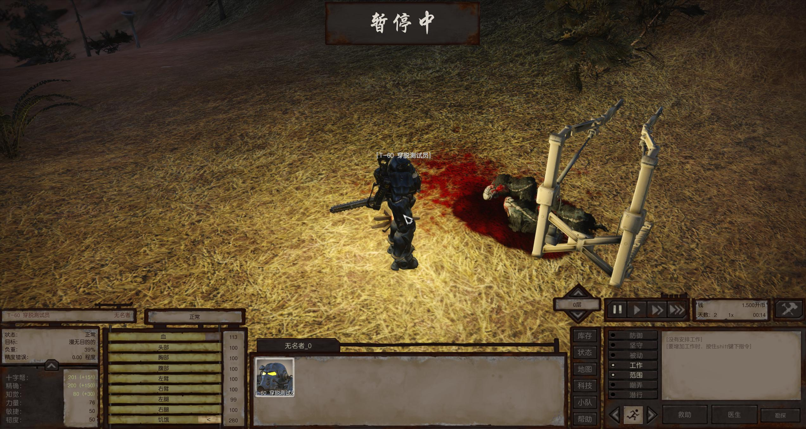

# 弹药100与自制动力甲制造站：本机安装及受控验收

结果分支 `test-machine/real-bridge-handoff-20261103` / Draft PR #1；仪器分支 `test-machine/single-readonly-observer-20261103` / Draft PR #4。不合并main。运行基底8a3d993加当时未提交的夹具修复，controller SHA256 `1c7ac7fdd454ad5536022365ba3b947b9dcf7dde95f2033970f431bd221fbe8c`；测试后提交为 **d89b4e28f7b7c6b3e3088837d9615247e5af0fc4**，逐字节核对一致，其他tracked源码未改。原始result/preflight仍写基底8a，不能当无补丁8a复测，见本机source-provenance.json。PR3远端仍d2809fd，无新生产释放修复。

## 内容及环境

Windows / Kenshi现有RE_Kenshi原生启动，正常权限Steam；实际EXE SHA256 504b362cde850d56afb1cea6f5b7b0ee014d9dd7b47e188599d91c804502cd3e。游戏根用GAME_ROOT、模组工程用MOD_PROJECT_ROOT、仪器用OBSERVER_ROOT代称。8文件安装清单和哈希见[脱敏摘要](evidence/station-ammo-20261103.json)。

两类弹药200/210 stackable 1→100；charges、重量、配方及高斯原生sound1保留。Energy.mod SHA256 `e85dbe46581ff0d7f424d745d862a0394ec969914e1701675a09f05b279e3bb2`。Craft.mod SHA256 `9d4bc5566a8ea7915dc56393095da10043b75f5efd5d6a0e97bedcba16a88c02`。自有建筑200改用自有part220/material221，未改原版共享smithy记录；原科技、成本、功能记录不变。

自制站体15184三角（7592正面+补背面），高度26.0023，原生Object材质；2048贴图DXT5/DXT5/DXT1共约13.33MiB，12级mip，7个静态箱体碰撞。没有运行时材质/声音hook或新轮询器。压缩mip降低贴图成本；大量摆放仍有额外网格、碰撞及绘制成本，整机FPS/多站与长时未验证。实机临时低贴图设置，加载日志1024级；原设置原字节恢复。

## 操作及证据

只用独立旧夹具T60_LIFE_096_ORDINARY_D，自动保存关闭，单执行者、无RPC锁。原生启动→固定load→穿甲稳定→craft create-armour→queue:armour→fill→operate（原生AI goal）→12次有界采样→暂停、halt/release、截图、计数、退出自建游戏及停桥；**未调用step/work加速**。本机命令 `python OBSERVER_ROOT/reports/station-grounded-20261103/configured_run.py`，它依赖本机历史驱动，不是仓库可独立运行的测试。驱动有一次性launch-intent防重复；重测必须建新证据目录，不能删除旧标记重跑。

| 阶段 | 实际结果 / 证据类别 |
| --- | --- |
| FCS编码/字段/引用及8文件安装hash | 静态通过；写前能字节还原旧文件，只改声明字段/新增自有记录 |
| 首轮模型加载与制作 | 72RPC无错误，原生完成1件，输入50→42各一类；两张图没站体，视觉不通过 |
| 近距离、floor=-1假设 | 均没看到；-1无效撤回，未改生产内容 |
| 新只读render观测 | visible=true、entities_loaded=true却在Y1123.534，角色Y561.888；定位到夹具重复加地形高度 |
| 修正factory Y=0 | 实际站Y561.647，模型落地、贴图与比例可见；截图由代理视觉检查，非用户人工认可 |
| 修正后原生制作 | 队列true→false、原生完成事件1件650、两输入50→42，power=true，work_calls=0；仅受控制作通过 |
| 单人资源 | 冷载0/0/0→穿甲1/1/1→制作后1/1/1（累计外观/Lua池项/材质槽）；非全引擎存活数 |
| 普通库存100弹药合并、自然研究施工搬料、完整碰撞/工作点、私有旧档科技UI | **未验证**；不由注料、原生事件或静态字段替代 |

原始progress_delta=0不能解释为制作失败：完成后队列被移除，不再有progress；修正驱动对此记null，以完成事件和耗料核对。五轮独立会话均无RPC错误、无新保存；所有原始日志/分阶段角色字段/连续内存在OBSERVER_ROOT/reports相应目录，未上传。场景没有活动战斗，但原档已有尸体；不据此宣称洁净世界或伤病闭环。

## 最小复现及修复

旧固定create-armour在海拔约561.9的单人场景，把actor.worldY传给室外factory的relativeY，实际站高度约1123.5，截图看不到。只读render证实实体已加载。仅把该固定工厂Y改0，保持X/Z偏移、floor=0、单人/暂停/无自动保存门禁不变；新会话同内容hash下站Y561.65并显示。floor=-1假设失败撤回；不要通过强制setVisible、任意Lua、free或放宽移动门禁修复。生产建筑模型和正常建造无需这个测试补丁。

## 旧存档

本次堆叠与模型替换没有改变科研解锁引用，不要求专门导入。对新增整套模组，通常冷启后读取旧档，再在“废土军械”完成对应科技即可；这是本地定义判断，私人旧档UI尚未验证。链锯4级、能量5级、电磁与动力甲6级；动力甲要求原护甲锻造/机器人学及本模组能量工程。研究完成才解锁建筑/配方，不是安装后自动获得。老建筑若保留旧外观先另存后重建一座；科技不显示先检查启用顺序、研究台等级与前置，不直接导入/改用户存档。

## 收尾与分析机下一步

五轮均退出自建游戏、停桥、RPC空闲，配置恢复、18项T60生产文件与固定存档未改；内存摘要逐会话保留，不因低于2GiB停测，不将完整游戏加载增长归因模组泄漏。原16/32/128上限及释放门禁不变，所有旧WIP保留。安装备份在MOD_PROJECT_ROOT/research/station_install_20261103/backup；本机release/Ammo100_station_content_20261103为8文件增量而非干净整合包，旧103文件候选保留。

1. 审查PR4夹具高度修正和只读render字段，保留原门禁；不要把已有高空站的制作记录称作地面接近/碰撞验证。
2. 提供最小受限自然施工/供电/搬料与完整碰撞/工作点观测接口，缺失组合继续阻塞；本机收到明确SHA后单独复测。
3. 继续独立修复分支的生产生命周期协议，私有释放历史成功不是生产回收完成，不重复旧trial。

共享仅文本配方、小型摘要和一张独立测试截图，无游戏/模型/贴图/.mod/DLL/存档/凭据/完整原始报告。完整记录以本文为最新，勿按旧“站体未安装”节点重跑。
